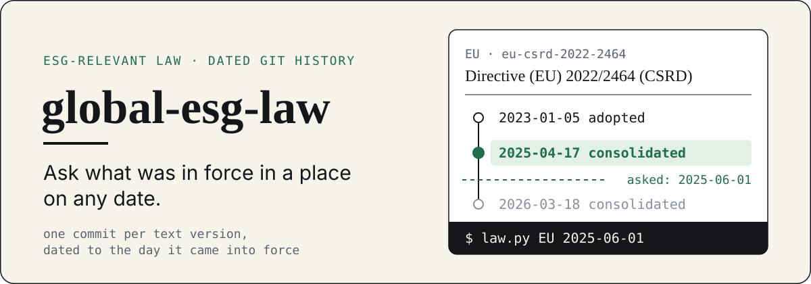
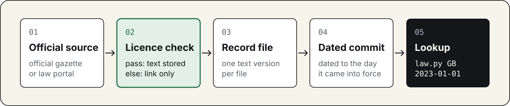
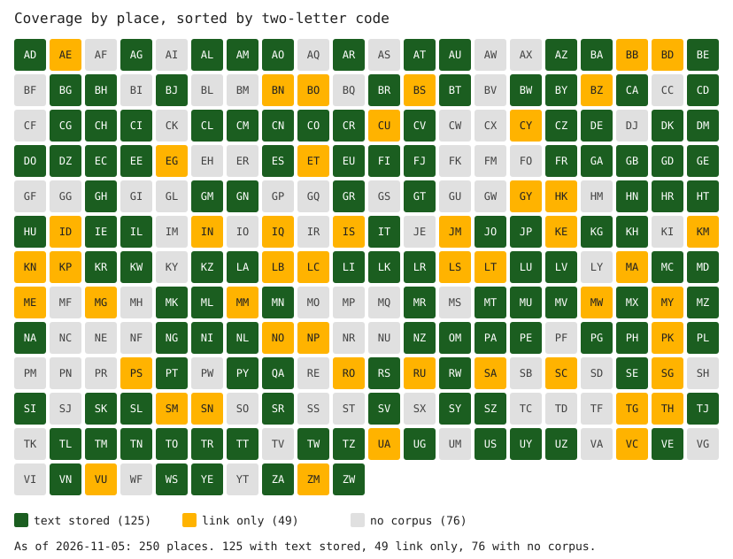

<p align="center">
  
</p>

<p align="center">
  <a href="LICENSE"></a>
  
  <a href="#known-limits"></a>
</p>

**Read ESG-relevant law as dated git history, and ask what was in force in a place on any date.**

Sustainability law changes often, and a consolidated text on a government site usually shows only today's wording. This repository keeps each version of a legal text as one git commit, dated to the day it came into force, so a lookup tool can return the law in force in a place on a given date. It is for people who need to check a reporting or climate duty against the wording that applied at the time: analysts, auditors, researchers and developers of compliance tools.

Text is stored for 140 places and for 831 of the 1378 instruments looked for (as of 2026-11-10). An instrument is one act, regulation, rule or guidance document. For the other 547 instruments the repository holds a link to the official page and no text.

This is not legal advice. The repository is a copy, the official source named in each commit is the authority, and nothing here says whether any company complies with any law.

Maintained by [GoCarbonTracker](https://gocarbontracker.net). Inspired by [lexifina/global-law](https://github.com/lexifina/global-law), which keeps the law of many countries as one git history. This repository applies the same idea to ESG-relevant law and adds a licence check on every source before any text is stored.

## How it works

<p align="center">
  
</p>

Each text comes from an official gazette or law portal. Its source is licence-checked first: the text is stored only on a `pass` verdict, and otherwise only a link is kept. Every stored version becomes one record file and then one commit dated to the day it came into force, and the lookup reads that history.

## Quick start

Needs Python 3.11 or later and git. The lookups read the `history` branch, the branch that holds one commit per text version. A fresh clone holds it as `origin/history`, so these commands pass `--ref origin/history`.

```
git clone https://github.com/GoCarbonTracker-Hq/global-esg-law && cd global-esg-law
python3 tools/law.py GB 2023-01-01 --ref origin/history
python3 tools/law.py CH 2025-06-01 --lang en --ref origin/history
```

The first lookup prints one line per instrument in force in Great Britain on that date. The second asks for the English text in Switzerland. First lines of output from a fresh clone:

```
gb-ca2006-s414a-414d	2022-04-06	consolidated	Companies Act 2006, Part 15 Chapter 4A, strategic report (sections 414A to 414D)
gb-ca2006-s414cb	2022-04-06	consolidated	Companies Act 2006, section 414CB (non-financial and sustainability information statement)
gb-uksi-2022-31	2022-04-06	adopted	The Companies (Strategic Report) (Climate-related Financial Disclosure) Regulations 2022
ch-co-art964a-c	2022-01-01	translation	Code of Obligations (SR 220), Sixth Division, Art. 964a to 964c: transparency on non-financial matters
  de	consolidated
  fr	consolidated
  it	consolidated
note ch-co-art964a-c: showing the en record
```

Each line gives the instrument id, the date that version came into force, its kind (`adopted`, `consolidated` or `translation`) and its title. The line shown is the official-language text, and the indented lines name every other language the same version exists in. `--lang <code>` returns that language where the version has it, and otherwise the official text with a note.

Places are identified by ISO 3166-1 alpha-2 code, plus `EU`. The general form is:

```
python3 tools/law.py <ISO2> <YYYY-MM-DD> [--repo PATH] [--ref history] [--lang CODE] [--json]
```

`--json` adds a `languages` list to each instrument. In Python: `in_force(iso2, on, repo=ROOT, ref="history", lang=None, detail=False) -> list[dict]`.

Three rules decide what counts as in force:

- A stayed or enjoined rule counts as in force on its date, and its status note is printed with it.
- An amendment published but not yet in force is listed after the line `not yet in force`.
- A circular or notice with no commencement clause takes its issue date.

## Questions it answers

Each question is answered by one command from the repository root.

- What was in force in Great Britain on 1 January 2023? `python3 tools/law.py GB 2023-01-01 --ref origin/history`
- Which languages does a Swiss law exist in? `python3 tools/law.py CH 2025-06-01 --ref origin/history`
- Is there an English text for it? `python3 tools/law.py CH 2025-06-01 --lang en --ref origin/history`
- What changed in Great Britain between 2020 and 2024? `diff <(python3 tools/law.py GB 2020-01-01 --ref origin/history) <(python3 tools/law.py GB 2024-01-01 --ref origin/history)`. Lines marked `<` are the 2020 answer and lines marked `>` the 2024 answer.
- What is announced in Estonia but not yet in force on 1 January 2026? `python3 tools/law.py EE 2026-01-01 --ref origin/history`
- Does a place with links only have any text? `python3 tools/law.py AE 2023-01-01 --ref origin/history` prints `no instruments stored for AE`.

## What is covered

The register (`register/register.csv`) is the list of every place and every instrument found for it, 250 places in all. Each place also has a scope file (`register/<ISO2>/scope.json`), which lists the instruments we looked for there with the official URL of each. A record is one file under `records/` holding one version of one text.

All figures are as of 2026-11-10. Each row names the command that produces it, run from the repository root.

| Measure | Value | Command |
|---|---|---|
| Places with stored text | 140 | `ls -d records/*/ \| wc -l` |
| Instruments with stored text, out of instruments in scope files | 831 of 1378 | `python3 tools/coverage.py`, then the Counts table in `COVERAGE.md` |
| Places with links only | 110 | same Counts table |
| Records stored (one file per text version) | 3240 | `find records -name '*.json' \| wc -l` |
| Records read by OCR (`"extraction": "ocr"`) | 104 | `grep -rl '"extraction": "ocr"' records \| wc -l` |
| Tests | 185 passed (run on 2026-11-12) | `python3 -m pytest tests -q` |



Each square is one place in the register, labelled with its two-letter code and sorted by code. It is a grid of codes and not a map. Dark green means text stored, amber means link only and grey means no scope file. As of 2026-11-10 that is 140, 110 and 0 places.

A place or instrument is link only for one of three reasons. The licence verdict for its source is not `pass`, so the text may not be copied. The host refuses automated requests. Or the text exists only as a scan we could not use.

### Law families

Every register row carries a law family code. The codes group instruments by the kind of duty they set.

| Family | What it covers |
|---|---|
| F1 | Sustainability disclosure and reporting |
| F2 | Climate and environment framework laws |
| F3 | Emissions and carbon pricing |
| F4 | Waste and products |
| F5 | Supply chain due diligence |
| F6 | Green claims and consumer protection |
| F7 | Everything else: energy, biodiversity, plans and other instruments listed for context |

F7 is the largest family in the register and no F7 text is stored. F4 and F5 are thin, and the gaps found by an audit of 13 places are in [issue #16](https://github.com/GoCarbonTracker-Hq/global-esg-law/issues/16).

[`COVERAGE.md`](COVERAGE.md) is the per-place map, generated by `python3 tools/coverage.py` with nothing typed by hand. Its Grid has one row per place and one column per law family, and each cell says how many texts are stored, when the source was last checked and when the law last changed. It calls places with a scope file "pilot places", a name from when there were four of them. Today that is every place.

The 110 places with links only are listed by code in [`COVERAGE.md`](COVERAGE.md) under Not covered.

<details>
<summary>Records stored per place (3240 in all, <code>find records/&lt;ISO2&gt; -name '*.json' | wc -l</code>)</summary>

AD 4, AG 2, AL 1, AM 7, AO 4, AR 7, AT 42, AU 85, AW 4, AX 6, AZ 19, BA 4, BE 57, BG 4, BH 7, BJ 6, BR 20, BT 17, BW 2, BY 6, CA 56, CD 1, CG 4, CH 109, CI 5, CK 3, CL 9, CM 4, CN 15, CO 8, CR 135, CV 5, CW 3, CX 1, CZ 24, DE 19, DK 32, DM 4, DO 10, DZ 12, EC 3, EE 65, ES 65, EU 35, FI 84, FJ 6, FK 9, FO 6, FR 38, GA 9, GB 10, GD 8, GE 134, GH 1, GL 16, GM 1, GN 7, GR 7, GT 3, HN 6, HR 28, HT 2, HU 13, IE 21, IL 2, IT 80, JE 23, JO 3, JP 130, KG 160, KH 3, KR 88, KW 1, KZ 379, LA 8, LI 73, LK 20, LR 2, LU 22, LV 68, MC 25, MD 11, MK 6, ML 6, MN 4, MO 4, MR 13, MT 62, MU 3, MV 7, MX 7, MZ 1, NA 3, NC 4, NF 5, NG 1, NI 4, NL 41, NR 8, NZ 64, OM 2, PA 6, PE 5, PG 5, PH 3, PL 33, PT 14, PW 3, PY 5, QA 8, RS 8, RW 35, SD 7, SE 11, SI 21, SK 88, SL 1, SR 3, SV 3, SY 1, SZ 4, TJ 2, TL 2, TM 16, TN 6, TO 24, TR 11, TT 1, TW 18, TZ 8, UG 3, US 34, UY 7, UZ 121, VE 2, VN 24, WS 3, YE 4, ZA 6, ZW 1

</details>

## How it is made and checked

The text was collected with AI assistance. AI agents (Anthropic's Claude models) worked from a written brief per place: they searched for the instruments, fetched each text from its official source and wrote the record files. The first 14 places were built and checked from hand-written briefs. Another 140 places followed in fifteen batches, and one further pass read scanned gazettes with OCR. Every place in the register now has a scope file.

The licence verdicts were drafted the same way. Before any text is stored, the source gets a row in `sources/licence-table.csv` with a verdict: `pass`, `permission requested`, `unknown` or `fail`. An AI model read the source's terms page or the country's copyright statute and wrote the verdict with the quoted wording it rests on. The `checked_by` column names the model on every row. The maintainer set the rule that text is stored only under a `pass` row and ruled on the cases the agents raised as unclear. No lawyer has reviewed the table.

Three automated checks ran on every addition before it was merged: `tools/check_corpus.py`, `tools/publish_gate.py` and the tests. The gate refuses a record whose source row is not `pass`, and it refuses a link-only entry that has records.

Watchers are small checks that notice when an official source changes, so a person can decide whether a new version belongs in the records. They are described in [`upkeep/README.md`](upkeep/README.md). The record format, rebuilding the history, the tests and the release checks are in [`MAINTAINING.md`](MAINTAINING.md).

## Known limits

- Two `pass` licence verdicts are in doubt. An audit of a sample of the licence table on 2026-11-12 is in [issue #18](https://github.com/GoCarbonTracker-Hq/global-esg-law/issues/18). Until it is closed, read the `Licence` trailer and the source's own terms before reusing a text.
- Tool defects found by a code review on 2026-11-12 are listed in [issue #17](https://github.com/GoCarbonTracker-Hq/global-esg-law/issues/17). No continuous integration runs the tests yet.
- Link-only instruments have no stored text: 547 of 1378 as of 2026-11-10.
- OCR text is uncorrected. 104 records are OCR, in 13 languages including Arabic, Spanish and French. Arabic OCR in particular misreads digits, so check dates and article numbers against the original PDF named in the record.
- 11 records have an unknown commencement date (`in_force` is null). They sit in the history at the date in their file name, which is a publication date.
- Some places hold their laws only as originally published, so a lookup there does not include later amendments. `COVERAGE.md` lists them under Not covered.
- The last 20 places added (territories, uninhabited places, Antarctica and Western Sahara) are pointers. Their laws are mostly those of a parent state, and 17 of the 20 have an empty scope file.
- The published `history` branch can trail `main`. As of 2026-11-10 it lacks one record, the Christmas Island plastic bag local law, so a lookup for CX prints `no instruments stored for CX`.
- Watchers run by hand and on no schedule. Many state sites refuse requests from cloud addresses, and the last full run on 2026-11-10 recorded 183 failures across 1557 watchers.

## Reporting a problem

Wrong or missing law, and questions about a source's licence, go to [GitHub issues](https://github.com/GoCarbonTracker-Hq/global-esg-law/issues). Name the place, the instrument and the official URL, and say what the record shows against what the source shows.

## Licence

Tools, tests, the register and the documentation are CC0 1.0 (`LICENSE`). The law texts are not covered by that dedication. Each record carries its own source licence in the `Licence` trailer of its commit on the `history` branch and in `sources/licence-table.csv`.

## Cite

GoCarbonTracker, global-esg-law, `history` branch built 2026-11-10 (commit `7b5ed3a7`), https://github.com/GoCarbonTracker-Hq/global-esg-law.

Add the instrument and its in-force date when you cite one text, for example "Directive (EU) 2022/2464 (CSRD), in force 2026-03-18". [`CITATION.cff`](CITATION.cff) holds the same details in machine-readable form.
